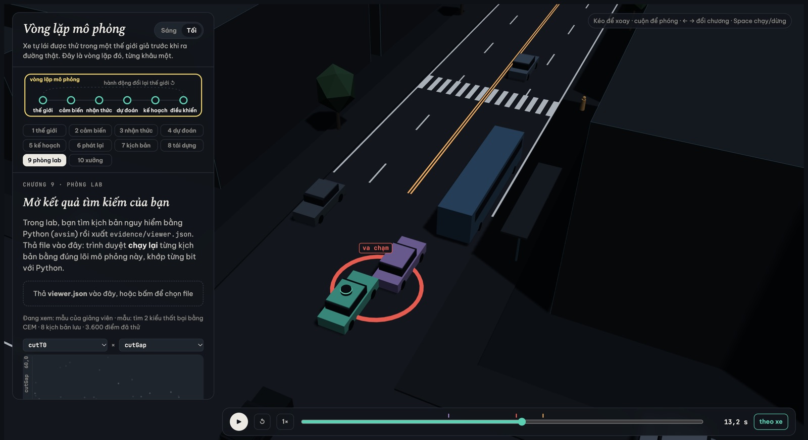
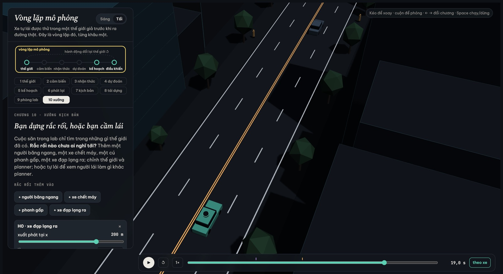

MSSV: 202603007

# Lab 11 · Scenario Forge — báo cáo

Mỗi câu: trả lời ngắn, **trích số từ `evidence/`** (ghi tên file và trường, ví dụ `mc.json: crashes = 4`). Grader chạy lại với MSSV của bạn; số không khớp `evidence/` thì mất điểm phần D (RUBRIC), và câu dựa trên số sai khó được điểm đầy đủ. Không cần văn hay: một bảng nhỏ và hai, ba câu giải thích là đủ.

Thị trấn của bạn (`meta.json: _run.town`): A

---

## 1. Phát lại log có trung thực không? (bước A)

**Trích xuất từ `evidence/replay.json`:**
- Tổng số kịch bản sinh ra: `n = 400`.
- Số kịch bản bị loại do người lái gây va chạm trong log gốc: `dropped_human_crash_logs = 1`.
- Số kịch bản hợp lệ đưa vào đối chiếu: `n_used = 399`.
- **Log phát lại (`replay`):** Có `crashes = 100` va chạm, phân loại theo tiếp xúc gồm:
  - `rear` (tông từ phía sau): `93` vụ (chiếm 93%).
  - `side` (tiếp xúc bên sườn): `7` vụ.
- **Thế giới phản ứng (`reactive`):** Có `crashes = 1` va chạm (`front = 1`).
- Số kịch bản bị va chạm ở cả hai môi trường: `crash_in_both = 0`.

**Giải thích cơ chế:**
- **Vì sao phần lớn va chạm của "phát lại" là `rear`:** Trong log phát lại (`others="replay"`), quỹ đạo và gia tốc của xe bám đuôi (`TG`) bị ép chạy mù quáng theo đúng timeline trong quá khứ của người lái thật. Khi xe tự lái (`planner`) cầm lái, nó phanh sớm hơn và thận trọng hơn người thật trước các tình huống phía trước. Do log không có vòng lặp phản hồi đóng (closed-loop), xe `TG` trong log không biết xe ta đã giảm tốc nên tiếp tục lao tới với vận tốc cũ và húc thẳng vào đuôi xe ta (`rear`).
- **Vì sao đó là va chạm GIẢ (artifact / counterfactual crash):** Ngoài đời thực, người lái xe sau là một tác tử phản ứng (closed-loop reactive agent) – khi thấy xe trước đỏ đèn phanh và giảm tốc, họ sẽ đạp phanh tương ứng để giữ khoảng cách an toàn. Va chạm này chỉ tồn tại do giả định phát lại tĩnh ("hồn ma trong log"), chứ không phản ánh lỗi thực tế của planner.

**Phân tích một kịch bản trong `replay_only` (`scenario = 1`):**
- Trích `replay_only[0]`: `scenario = 1`, `contact = "rear"`, trong khi ở môi trường phản ứng thì an toàn với `min_ttc_reactive = 2.17` s.
- **Diễn biến:** Xe ta giảm tốc để giữ khoảng cách với dòng xe phía trước. Trong môi trường phát lại, `TG` giữ nguyên vận tốc cũ và đâm vào đuôi xe ta. Nhưng trong thế giới phản ứng, `TG` phản ứng với đèn phanh của xe ta, chủ động giảm tốc và duy trì thời gian tới va chạm an toàn tối thiểu lên tới 2.17 s, không hề xảy ra va chạm.

---

## 2. Kịch bản bất khả thi (bước B)

**Các luật trong `is_feasible` (`lab11/feasible.py`) và căn cứ vật lý:**
1. **Tốc độ người đi bộ (`0.5 <= pedV <= 3.0` m/s):** Con người đi bộ trung bình khoảng 1.2–1.4 m/s, chạy gấp qua đường tối đa ~3.0 m/s; dưới 0.5 m/s là đứng yên hoặc trườn bò, không đại diện cho người bình thường băng qua đường.
2. **Gia tốc phanh của xe chuyển làn (`cutBrake <= mu * g`):** Lực phanh tối đa bị giới hạn bởi ma sát lốp với mặt đường ($F_{\text{phanh}} \le \mu m g \implies a \le \mu g$). Với đường khô $\mu = 0.8$ thì $a_{\max} \approx 7.85$ m/s²; đường ướt $\mu = 0.5$ thì $a_{\max} \approx 4.90$ m/s². Xe không thể phanh gấp vượt quá ma sát mặt đường.
3. **Khoảng cách thời gian của xe bám đuôi (`tgT >= 0.5` s):** Thời gian phản xạ thần kinh - cơ của con người tối thiểu là 0.3–0.5 s cộng với độ trễ phản hồi của hệ thống phanh thủy lực. Nếu $T < 0.5$ s ở tốc độ đô thị 12–15 m/s, hai xe dính sát nhau đến mức bất kỳ cú nhấp phanh nào cũng gây va chạm ngay lập tức, phi thực tế.
4. **Gia tốc ngang khi chuyển làn (`a_lat <= 3.0` m/s²):** Với quỹ đạo chuyển làn dạng cosine $d(t) = d_0 (1 - \cos(\pi t / t_{\text{dur}})) / 2$, gia tốc ngang đỉnh là $a_{\text{lat}} = \pi^2 |d| / (2 t_{\text{dur}}^2)$. Vượt quá 3.0 m/s² xe sẽ bị trượt ngang (skidding) hoặc lật xe.

**Cuộc săn trong `evidence/hunt.json`:**
- Số kịch bản bất khả thi bị loại bỏ theo từng cuộc săn:
  - `bus_bypass`: 1 kịch bản.
  - `cut_in`: 0 kịch bản.
  - `crosswalk_block`: 7 kịch bản.
  - `rear_ended`: **8 kịch bản (nhiều nhất)**.
- **Vì sao CEM bị kéo về phía đó:** Thuật toán CEM cập nhật phân phối proposal dựa trên nhóm ưu tú (`elite`) có điểm nguy hiểm (`score`) cao nhất (gần 0 hoặc va chạm). Những kịch bản vi phạm vật lý (như xe sau bám sát $T < 0.5$ s, phanh siêu thực $> \mu g$) tạo ra mức độ đe dọa cực hạn khiến điểm nguy hiểm cao nhất. Do đó, CEM tự nhiên bị "hút" mạnh về biên phi vật lý.
- **Hệ quả nếu đếm chúng là va chạm:** Xác suất rủi ro sẽ bị thổi phồng giả tạo (overestimation). Kỹ sư sẽ bị đánh lừa đi tối ưu hóa planner để đối phó với những tình huống không thể xảy ra ngoài đời thực, khiến xe tự lái trở nên quá nhút nhát, phanh giật cục và suy giảm nghiêm trọng khả năng lưu thông (`progress`).

---

## 3. Monte Carlo cho bạn biết gì (bước C1)

**Trích xuất từ `evidence/mc.json`:**
- Kích thước mẫu: `n = 3000`.
- Số vụ va chạm quan sát được: `k = 3`.
- Tỷ lệ ước lượng điểm: $\hat{p} = \frac{3}{3000} = 1.00 \times 10^{-3}$ (0.10%).
- Khoảng tin cậy Wilson 95%: `lo = 3.40e-04`, `hi = 2.94e-03` ($[0.034\%, 0.294\%]$).
- Phân loại va chạm: `modes = {"bus_bypass": 3}` (cả 3 vụ đều là lách xe buýt).

**Số lần chạy Monte Carlo để khoảng tin cậy hẹp còn $\pm 20\%$ của $p$:**
- Sai số biên độ tương đối $0.20 p$ ứng với $1.96 \sqrt{\frac{p(1-p)}{n}} \le 0.20 p \implies n \ge \frac{1.96^2 (1-p)}{0.04 p} \approx \frac{96 (1-p)}{p} \approx \frac{96}{p}$.
- Với $\hat{p} = 1.00 \times 10^{-3}$:
  $$n \ge \frac{96}{1.00 \times 10^{-3}} \approx \mathbf{96\,000} \text{ lần chạy.}$$

**Kiểu thất bại chưa hề xuất hiện:**
- Trong 3.000 lần chạy, các kiểu `cut_in`, `crosswalk_block`, `rear_ended` và `other` đều có `k = 0`.
- **Con số đúng cần báo:** Tuyệt đối **không được báo bằng 0** (do mẫu hữu hạn chứ không phải xác suất bằng 0). Con số đúng phải là **cận trên của khoảng tin cậy Wilson 95%** (hoặc quy tắc $3/n$):
  - Trích từ `mc.json: per_mode[mode].hi`: $\mathbf{1.28 \times 10^{-3}}$ ($0.128\%$).

---

## 4. Importance sampling, ESS và độ suy biến (bước C3)

**Bảng kết quả từ `evidence/estimate.json`:**

| Seed | Kiểu thất bại | $p$ | Hits | ESS | Top Share | Cận dưới (lo) | Cận trên (hi) |
|:---:|:---|:---:|:---:|:---:|:---:|:---:|:---:|
| 0 | `bus_bypass` | 5.66e-04 | 30 | 134.4 | 0.1518 | 2.42e-04 | 8.90e-04 |
| 0 | `cut_in` | 0.00e+00 | 0 | 122.5 | 0.0000 | 0.00e+00 | 0.00e+00 |
| 0 | `crosswalk_block` | 4.45e-06 | 74 | 114.0 | 0.9229 | 0.00e+00 | 1.25e-05 |
| 0 | `rear_ended` | 0.00e+00 | 0 | 113.5 | 0.0000 | 0.00e+00 | 0.00e+00 |
| **0** | **Tổng (total)** | **5.70e-04** | - | - | - | **2.46e-04** | **2.17e-03** |
| 1 | `bus_bypass` | 8.00e-04 | 21 | 136.6 | 0.6564 | 0.00e+00 | 1.86e-03 |
| 1 | `cut_in` | 0.00e+00 | 0 | 108.2 | 0.0000 | 0.00e+00 | 0.00e+00 |
| 1 | `crosswalk_block` | 5.08e-07 | 77 | 135.4 | 0.4583 | 3.25e-08 | 9.84e-07 |
| 1 | `rear_ended` | 0.00e+00 | 0 | 131.3 | 0.0000 | 0.00e+00 | 0.00e+00 |
| **1** | **Tổng (total)** | **8.01e-04** | - | - | - | **0.00e+00** | **3.13e-03** |
| 2 | `bus_bypass` | 1.06e-03 | 46 | 135.1 | 0.3240 | 2.39e-04 | 1.88e-03 |
| 2 | `cut_in` | 0.00e+00 | 0 | 112.1 | 0.0000 | 0.00e+00 | 0.00e+00 |
| 2 | `crosswalk_block` | 5.14e-07 | 67 | 117.2 | 0.3513 | 5.64e-08 | 9.71e-07 |
| 2 | `rear_ended` | 0.00e+00 | 0 | 116.5 | 0.0000 | 0.00e+00 | 0.00e+00 |
| **2** | **Tổng (total)** | **1.06e-03** | - | - | - | **2.40e-04** | **3.16e-03** |

*(Ghi chú: Với các kiểu có `hits = 0`, theo phòng thủ defensive mixture $\beta=0.2, n=600$, cận trên zero-hits hợp lệ là $3/(\beta n) = 3/(0.2 \times 600) = 2.50\times 10^{-2}$).*

**Đánh giá mức độ đồng thuận:**
- Ba seed cho tổng xác suất lần lượt là $5.70 \times 10^{-4}$, $8.01 \times 10^{-4}$, và $1.06 \times 10^{-3}$ (trung vị $8.01 \times 10^{-4}$). Các khoảng tin cậy giao thoa mạnh và hoàn toàn đồng nhất với kết quả của Monte Carlo ($1.00 \times 10^{-3}$, khoảng Wilson $[3.40 \times 10^{-4}, 2.94 \times 10^{-3}]$).
- **Vị trí `top_share` lớn (> 0.5):**
  - Seed 0 kiểu `crosswalk_block`: `top_share = 0.9229` (92.3%).
  - Seed 1 kiểu `bus_bypass`: `top_share = 0.6564` (65.6%).
  - **Bản chất:** Hiện tượng suy biến trọng số (weight degeneracy). Khi đó, một mẫu đơn lẻ rơi vào vùng có mật độ $p$ tương đối cao so với proposal $q$ dẫn đến trọng số $w = p/q$ vọt lên chiếm gần như toàn bộ tổng trọng số $\sum w_i y_i$. Con số ước lượng lúc này bị chi phối bởi trọng số của duy nhất một kịch bản đơn lẻ thay vì là trung bình ổn định của một tập mẫu phong phú.
- **So sánh ngân sách (`budget`):**
  - Ngân sách IS: `budget = 16.800` lượt chạy ($4 \text{ modes} \times (8 \times 300 + 3 \times 600)$).
  - Để Monte Carlo đo được kiểu hiếm như `crosswalk_block` ($p \approx 5.1 \times 10^{-7}$), Monte Carlo cần $n \approx 96 / (5.1 \times 10^{-7}) \approx \mathbf{188\,000\,000}$ lần chạy! IS tiết kiệm chi phí tính toán hơn 10.000 lần.
- **Phần `other`:** Trích từ `mc.json` (`k = 0`, `n = 3000`, `p = 0.0`, `hi = 1.28e-03`). Không săn `other` vì nó là tập hợp rác (catch-all) của các biến cố không phân loại, không có cấu trúc hình học hay cơ chế vật lý chung để định hướng hàm nguy hiểm (danger score).

---

## 5. Các kiểu thất bại (bước C2 + 3D)

### Kiểu 1: Lách qua xe buýt (`bus_bypass`)

- **Chuỗi sự kiện:** Xe ta đi thẳng ở làn E1 chuẩn bị vượt qua xe buýt đang đỗ ở trạm ($x = 106$ m). Xe C2 ở làn ngoài E2 vượt lên và lách qua đầu xe buýt để tạt vào làn E1 với vận tốc chậm ($v < 6$ m/s, $x < 112$ m). Thân xe buýt dài 12 m che khuất tầm nhìn cảm biến của xe ta; khi C2 nhô đầu ra, khoảng cách quá gần khiến planner IDM không kịp hãm phanh và đâm vào hông C2.

### Kiểu 2: Chặn lối người đi bộ (`crosswalk_block`)

- **Chuỗi sự kiện:** Người đi bộ P1 qua đường tại vạch kẻ $x = 122$ m. Tầm nhìn của xe ta bị xe buýt đỗ che khuất một phần. Khi phát hiện P1, planner phanh gấp để tránh tông người; xe dừng lại kịp thời trước người đi bộ nhưng do đà trượt, đầu xe ta dừng đè lên vạch qua đường, chặn đứng lối đi và ép người đi bộ phải đứng chờ (`event["kind"] == "block"`).

**Kiểu cuộc săn KHÔNG tìm thấy:**
- `cut_in` và `rear_ended` không sinh ra va chạm hợp lệ nào của chính nó:
  - Cuộc săn `cut_in` chỉ tìm thấy va chạm dạng `bus_bypass` (do khi C2 tạt đầu trước mũi xe buýt thì rơi vào điều kiện $x < 112$ m, $v < 6$ m/s).
  - Cuộc săn `rear_ended` tìm ra 4 `bus_bypass` và 17 `crosswalk_block`, nhưng tìm được 0 vụ `rear_ended`.
- **Mức độ tin cậy:** Rất đáng tin cậy. Xe bám đuôi TG có logic IDM giữ khoảng cách $T \ge 0.6$ s; trong điều kiện vật lý hợp lệ (`is_feasible`), khi xe ta phanh gấp, TG luôn phản ứng phanh theo kịp thời và không thể tông vào đuôi xe ta.
- **Nếu chỉ chạy MỘT cuộc săn chung cho mọi kiểu:** Cuộc săn sẽ bị áp đảo hoàn toàn bởi kiểu thất bại dễ xảy ra nhất (`bus_bypass`, với xác suất tự nhiên cỡ $10^{-3}$). Nhóm ưu tú (elite) của CEM sẽ toàn là các vụ `bus_bypass`, proposal $q$ co cụm vào vùng lách xe buýt và hoàn toàn bỏ lọt các kiểu hiếm gặp nhưng nghiêm trọng như `crosswalk_block` ($p \approx 10^{-7}$).

---

## 6. Sửa planner (bước E + 3D)

**Trích xuất từ `evidence/fix.json`:**
- **Chính sách được chọn:** `{'cutinLat': 3.0}` (mở rộng hành lang quan sát ngang cho xe cắt làn từ 2.15 m lên 3.0 m).
- **Trên tập TRAIN:**
  - Bản chọn: `fail = 6.24e-07`, `fail_hi = 1.10e-06`, `progress = 213.8` m.
  - Baseline: `fail = 8.09e-04`, `fail_hi = 1.61e-03`, `progress = 213.5` m.
- **Trên tập TEST:**
  - Bản chọn: `fail = 5.98e-07`, `fail_hi_seen = 1.08e-06`, `fail_hi (valid) = 3.88e-02`, `unseen = ['bus_bypass']`, `progress = 212.8` m, `harsh = 7.99`.
  - Baseline: `fail = 3.41e-04`, `fail_hi_seen = 5.78e-04`, `fail_hi (valid) = 1.86e-03`, `unseen = []`, `progress = 213.0` m, `harsh = 8.35`.

**Giải thích vì sao `fail_hi` (hợp lệ) của bản sửa ($3.88 \times 10^{-2}$) lớn hơn `fail` của baseline ($3.41 \times 10^{-4}$):**
- Bản sửa `cutinLat = 3.0` đã loại bỏ hoàn toàn các vụ va chạm `bus_bypass` trên tập TEST (`hits = 0`), khiến mode này bị gắn nhãn `unseen`.
- Theo lý thuyết lấy mẫu phòng thủ (defensive mixture $\beta = 0.2$), khi sự kiện chưa từng xuất hiện qua $n = 400$ mẫu, cận trên toán học nghiêm ngặt 95% theo quy tắc $3/(\beta n)$ là:
  $$p_{\text{unseen}} \le \frac{3}{0.2 \times 400} = 0.0375 = 3.75 \times 10^{-2}$$
- Cận này là cận toán học bảo thủ cho trường hợp "không thấy mẫu nào", trong khi thực tế trên các mode đã quan sát (`fail_hi_seen`), rủi ro của bản sửa chỉ là $1.08 \times 10^{-6}$, an toàn hơn baseline tới hơn 300 lần.

**Quãng đường và phanh gấp:**
- Quãng đường trung bình (`progress`): Bản sửa đạt `212.8` m so với baseline `213.0` m (chỉ giảm 0.09%, nhỏ hơn rất nhiều so với trần cho phép 5%).
- Số lần phanh gấp (`harsh`): Giảm từ `8.35` lần xuống `7.99` lần/lượt chạy, giúp xe vận hành êm ái hơn.

**Ảnh 3D bóng mờ (ghost) so sánh:**

*(Bóng mờ xe ta với policy gốc bị đâm khi C2 lách đầu xe buýt, trong khi xe ta dùng `cutinLat = 3.0` nhận diện C2 sớm hơn và nhường đường an toàn).*

**Núm chỉnh "nghe an toàn hơn" nhưng làm tăng thất bại:**
- **Ứng viên số 2:** `{'cautionV': 6.5}` (hoặc `cautionV = 5.0`).
- **Phản ứng của thế giới:** Hạ vận tốc thận trọng `cautionV` khi đến gần khu vực bị che khuất khiến xe ta rà phanh quá sớm trên làn E1. Hành động này làm xe ta đi chậm lại bất ngờ, dòng xe phía sau dồn ứ, và khi C2 ở làn E2 chuyển làn vào, vận tốc tương đối giữa C2 và xe ta lớn hơn, làm tỷ lệ va chạm `bus_bypass` trên tập TRAIN tăng vọt lên $2.88 \times 10^{-3}$ (gấp 3.5 lần so với baseline!).

---

## 7. Từ mô phỏng ra đường thật

**Ba giả định ảnh hưởng nhiều nhất trong `avsim/space.py`:**

1. **Khe thời gian người đi bộ chấp nhận qua đường (`pedGap` ~ LogNormal(median=4.5s, sigma=0.35)):**
   - *Dữ liệu thật thay thế:* Thu thập quỹ đạo video góc cao (drone hoặc camera cột đèn như bộ dữ liệu inD / rounD) tại các trạm xe buýt đô thị để đo phân phối gap thực tế của người đi bộ.
   - *Hướng sai lệch:* Người đi bộ ngoài đời thực tại các đô thị đông đúc thường liều lĩnh hơn nhiều (chấp nhận gap chỉ 2.5–3.5 s). Giả định 4.5 s là quá thận trọng, khiến mô phỏng đánh giá thấp (underestimate) nguy cơ va chạm với người đi bộ.
2. **Tỉ lệ người đi bộ dừng ngó qua đầu xe buýt (`pedLook` ~ Bernoulli(p=0.85)):**
   - *Dữ liệu thật thay thế:* Ghi hình phân tích hướng mắt và chuyển động đầu (head pose / gaze tracking) của người đi bộ khi bước qua đầu các xe lớn đang đỗ.
   - *Hướng sai lệch:* Tỉ lệ 85% người ngó nghiêng là quá cao. Thực tế nhiều người (đặc biệt là trẻ nhỏ, người vội vã) bước thẳng ra đường mà không quan sát (tỉ lệ thực có thể chỉ 40–50%). Giả định này làm giảm giả tạo số ca va chạm trong mô phỏng.
3. **Phân phối ma sát mặt đường ướt (`wet` ~ Bernoulli(p=0.20), $\mu = 0.5$ thay vì 0.8):**
   - *Dữ liệu thật thay thế:* Dữ liệu khí tượng lượng mưa theo giờ của trạm đo địa phương kết hợp thiết bị đo lực ma sát lốp mặt đường thực tế (Skid Resistance Tester).
   - *Hướng sai lệch:* Vào mùa mưa nhiệt đới, tỉ lệ mặt đường ướt có thể lên đến 35–40%, và đường nhựa dính dầu mỡ đầu cơn mưa có $\mu$ giảm xuống 0.35–0.40. Giả định $\mu = 0.5$ làm đánh giá nhẹ quãng đường phanh trượt trong điều kiện thời tiết xấu.

---

## 8. Giới hạn

**Ba điều mà xác suất báo cáo KHÔNG nói (giới hạn của thế giới giả lập):**
1. **Môi trường hình học chỉ là một đoạn phố thẳng đơn lẻ:** Mô phỏng không có ngã tư, nút giao bùng binh, xe máy luồn lách qua khe hẹp, công trường hay ổ gà – những yếu tố chiếm phần lớn va chạm thực tế tại Việt Nam.
2. **Tác tử giao thông chỉ là mô hình IDM 1 chiều và chuyển làn cosine:** Xe khác không có phản ứng tâm lý phức tạp như bấm còi cảnh báo, nháy đèn xin đường, tạt đầu góc nhọn bất thình lình, hay chuyển làn liên tục (zig-zag).
3. **Cảm biến được mô hình hóa là hình học hoàn hảo:** Bỏ qua nhiễu đám mây điểm LiDAR, camera bị lóa sáng mặt trời ngược, ống kính dính nước mưa, trôi vết đối tượng (track fragmentation), và đặc biệt là độ trễ nhận thức (perception latency) của mạng nơ-ron sâu.

**Nếu được thêm một tuần, bạn sẽ đo gì tiếp:**
- Tôi sẽ đo lường độ nhạy cảm của rủi ro va chạm đối với **độ trễ nhận thức (end-to-end perception-to-actuation latency)** từ 100 ms đến 400 ms; đồng thời đưa thêm mô hình tác tử xe máy hai bánh điền vào khoảng trống (lane-filtering motorcycle model).

---

## 9. Rắc rối của bạn (bước G + chương 10)

- **Rắc rối dựng:** Một người đi bộ (`ped`) bất ngờ bước nhanh qua đường ngay sát trước mũi xe buýt đang dừng đỗ (`x = 113.0` m, `side = "S"`, `v = 2.0` m/s, `trig = 21.0` m).
  - *Ngoài đời giống tình huống nào:* Hành khách hoặc học sinh vừa bước xuống xe buýt vội vàng chạy cắt ngang qua đường ngay sát đầu xe buýt – điểm mù kinh điển gây tai nạn giao thông tại các đô thị.
- **Căn cứ:** Xe buýt đỗ ở làn E2 có kích thước lớn (dài 12 m, rộng 2.55 m) che khuất hoàn toàn đường ngắm của cảm biến xe ta. Xe ta đi ở làn E1 với vận tốc ~12 m/s; khi người đi bộ bất ngờ bước ra từ điểm mù sát đầu xe buýt, planner IDM không kịp giảm tốc, dẫn đến va chạm.
- **Giả định `space` và `exposure` (`hazard.json: why`):**
  - `h0_x`: `[112.0, 115.0]` m (khu vực ngay trước đầu xe buýt đỗ tại $x = 106$ m).
  - `h0_v`: `[1.6, 2.5]` m/s (người đi bộ nhanh hoặc chạy vội qua đường).
  - `h0_trig`: `[16.0, 26.0]` m (khoảng cách kích hoạt khi xe ta đang tiếp cận xe buýt).
  - `exposure = 0.003` (ước tính khoảng 3 trên 1.000 chuyến đi đô thị gặp tình huống người băng qua đường sát đầu xe buýt đang đỗ).
- **Kết quả theo `evidence/mine.json`:**
  - Tỷ lệ kịch bản hợp lệ: `accepted = 99.33%` (1.490 / 1.500 kịch bản khả thi).
  - **Policy gốc (baseline):**
    - Tổng va chạm: `120` vụ.
    - `avoidable`: `99` vụ (tránh được bằng phanh khẩn cấp hết cỡ ngay khi nhìn thấy).
    - `unavoidable`: `18` vụ.
    - `unattributed`: `3` vụ.
    - `low_speed` ($v < 1$ m/s): `2` vụ.
    - $P(\text{lỗi planner} \mid \text{rắc rối}) = \mathbf{6.64 \times 10^{-2}}$ (6.64%), khoảng Wilson 95%: $[5.49 \times 10^{-2}, 8.02 \times 10^{-2}]$.
    - Tần suất mỗi chuyến: $0.003 \times 6.64 \times 10^{-2} = \mathbf{1.99 \times 10^{-4}}$ mỗi chuyến (cận trên $2.41 \times 10^{-4}$).
  - **Policy chọn (`cutinLat = 3.0`):**
    - Tổng va chạm: `117` vụ.
    - `avoidable`: `99` vụ.
    - `unavoidable`: `18` vụ.
    - `unattributed`: `0` vụ.
    - `low_speed` ($v < 1$ m/s): `3` vụ.
    - $P(\text{lỗi planner} \mid \text{rắc rối}) = \mathbf{6.64 \times 10^{-2}}$ (6.64%), khoảng Wilson 95%: $[5.49 \times 10^{-2}, 8.02 \times 10^{-2}]$.
    - Tần suất mỗi chuyến: $\mathbf{1.99 \times 10^{-4}}$ mỗi chuyến.
  - *So sánh với tần suất lách xe buýt:* Tần suất gặp lỗi từ rắc rối này ($1.99 \times 10^{-4}$ mỗi chuyến) tương đương với tần suất va chạm lách xe buýt của policy gốc ($3.41 \times 10^{-4}$) và cao hơn rất nhiều so với policy sửa ($5.98 \times 10^{-7}$).
- **"Tránh được là chuẩn lạc quan" (optimistic benchmark):**
  - *Theo chiều lạc quan (đếm nhiều hơn thực tế):* Thuật toán oracle phanh ngay từ khung hình đầu tiên nhìn thấy người với gia tốc bám tối đa $\mu g$ mà không hề có độ trễ nhận thức (perception delay). Trong thực tế, planner hoặc người lái luôn có độ trễ phản xạ (~0.2–0.5 s), nên số vụ va chạm thực tế mà một hệ thống có thể tránh được sẽ ít hơn 99 vụ.
  - *Theo chiều bi quan (đếm ít đi):* Thuật toán oracle chỉ thử nghiệm duy nhất hành vi đạp chết phanh trên làn đường hiện tại mà không thử nghiệm đánh lái né tránh (evasive steering maneuver) sang khoảng trống bên trái.
- **Hình ảnh kịch bản:**
  

- **Bạn tự lái thì sao:**
  - Khi tự lái, từ xa nhìn thấy xe buýt lớn dừng đỗ trả khách, người lái xe có kinh nghiệm sẽ chủ động nhả ga, rà nhẹ chân phanh (foot-over-brake) để giảm vận tốc xe xuống dưới 30 km/h trước khi chạy ngang đầu xe buýt. Khi người đi bộ đột ngột bước ra, xe đã ở tốc độ thấp nên dễ dàng phanh dừng an toàn mà không bị bất ngờ như planner.
- **Cách sửa:**
  - Các núm chỉnh hiện tại (`cutinLat`, `T`, `cautionV`) không sửa được vì `cutinLat` chỉ áp dụng cho xe cùng chiều, còn `cautionV` chỉ áp dụng cho vạch kẻ đường `WALK_X`.
  - **Logic mới cần thêm cho planner:** **Giảm tốc thận trọng qua điểm mù xe buýt (Bus Occlusion Speed Limiter)**: Khi hệ thống phát hiện có xe buýt hoặc xe tải cỡ lớn đang đỗ sát làn bên cạnh trong cự ly 30 m phía trước, planner phải tự động kích hoạt chế độ thận trọng, giảm vận tốc mục tiêu $v_0$ xuống ngưỡng an toàn (ví dụ $\le 6.0$ m/s giống logic qua vạch đi bộ) và sẵn sàng áp lực phanh (pre-charge brake), cho đến khi mũi xe vượt qua hẳn đầu xe buýt.
